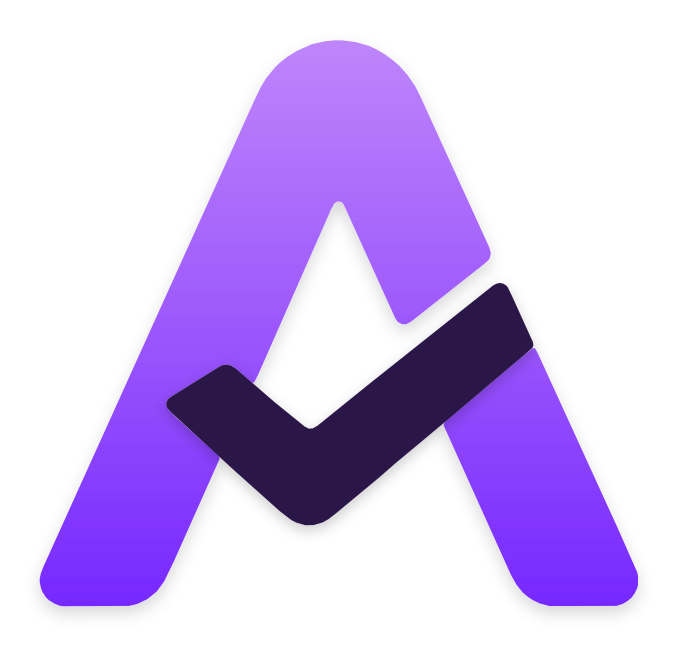
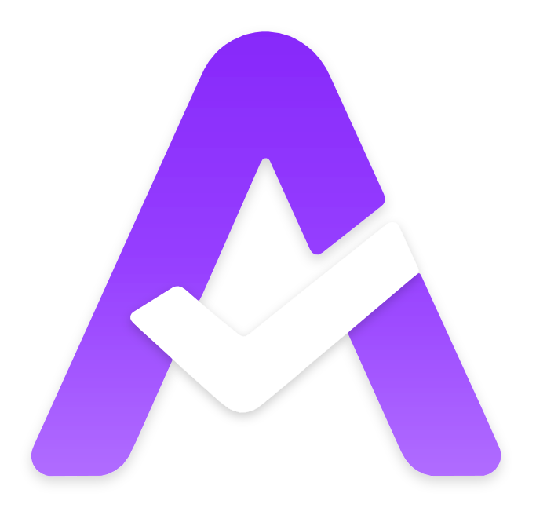
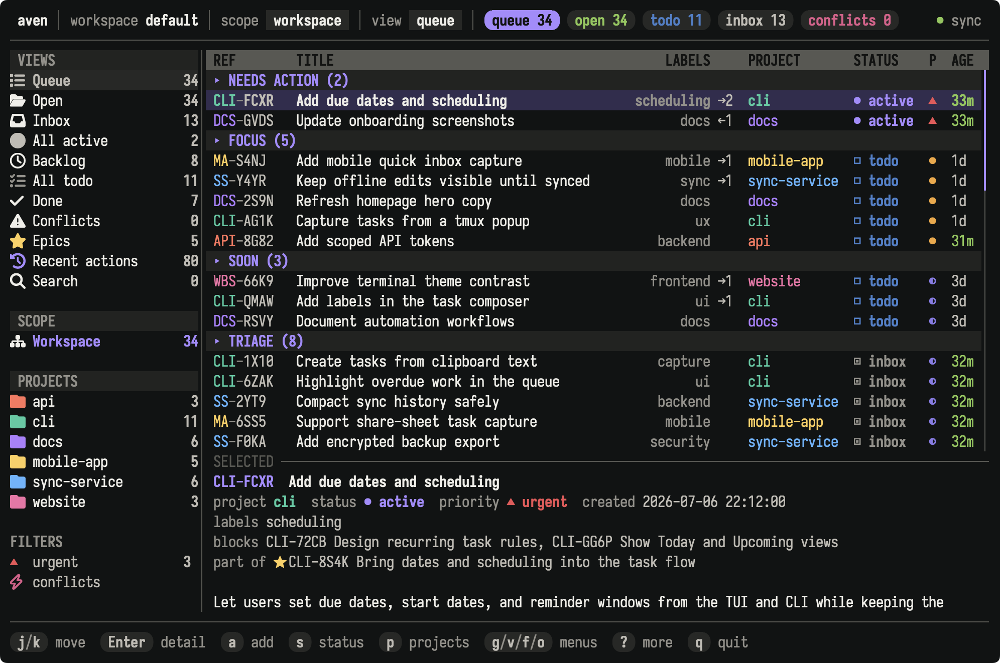
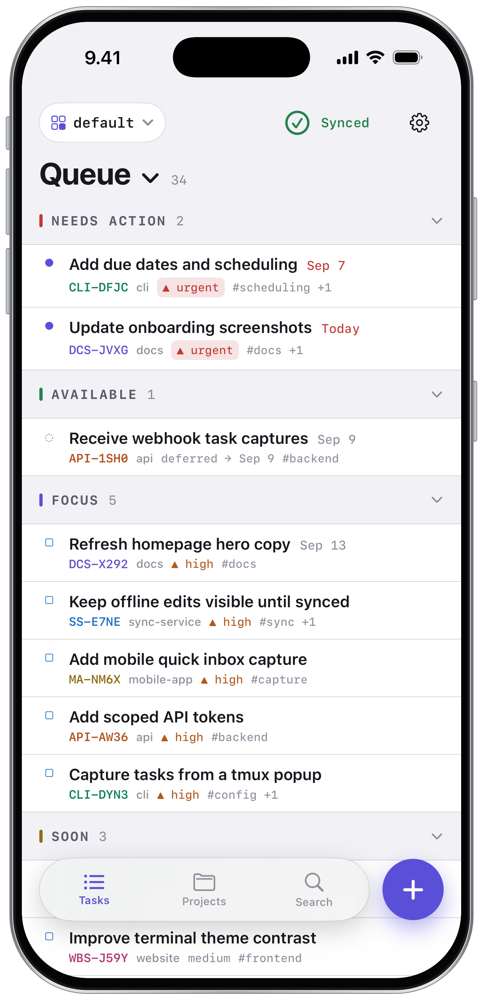
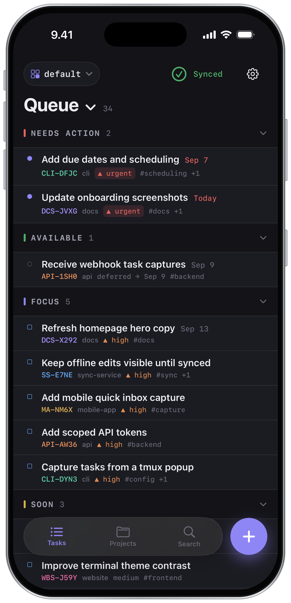

<h1>
  <a href="https://aventasks.dev#gh-light-mode-only"></a>
  <a href="https://aventasks.dev#gh-dark-mode-only"></a>
  aven
</h1>

`aven` is a local-first task manager for power users and agents. It gives you one overview across
projects, task capture from wherever work appears, first-class agent workflows, workspace isolation,
and a polished terminal UI.

It is currently under active development, but already works really well and I use it as my daily
driver.

If you've tried aven, feedback is welcome! Please
[open an issue](https://github.com/raine/aven/issues) to share it.

If you find aven useful, consider sharing it with others who might benefit from it.

Follow [@aventasksdev](https://x.com/aventasksdev) on X for updates.

Docs: <https://aventasks.dev/getting-started/>

<p>
  <a href="meta/tui.webp"></a>
  <a href="meta/ios-light.webp#gh-light-mode-only"></a>
  <a href="meta/ios-dark.webp#gh-dark-mode-only"></a>
</p>

*Your tasks, away from the terminal. Aven for [iPhone](https://apps.apple.com/app/aven-tasks/id6811171767)
and [Android](https://play.google.com/store/apps/details?id=fi.zendit.aven) pairs with your sync.
See [the mobile apps](https://aventasks.dev/mobile/).*

## Why aven?

I built this to solve these problems for myself:

1. I need one place to see tasks across all of my projects, so I can tell what
   needs doing right now. That's the [queue view](https://aventasks.dev/concepts/#queue).
2. I live in the terminal and want an excellent, keyboard-driven
   [TUI](https://aventasks.dev/tui/) that I can launch in a tmux popup, showing
   tasks for the project I'm currently in.
3. Adding tasks should just work, based on the current
   directory. Projects shouldn't need to be created separately.
4. I need to add tasks from my phone whenever an idea comes up away from the
   keyboard, and see them in the same task list. This is where the
   [mobile apps](https://aventasks.dev/mobile/) and sync come in.
5. I want to run the [sync server](https://aventasks.dev/sync/setup/) myself, on
   a home server like a Raspberry Pi, instead of depending on someone else's
   service.
6. It has to be local-first. Everything works offline and stays fast because
   nothing waits on the network, and sync is optional.
7. Tasks should live separately from the repo, so that they are not tied to git state.
8. Agents should be connected to the same task system, with a
   [CLI](https://aventasks.dev/agents/) optimized just for them.

Beyond that, each task gets a short Jira/Linear-style ID such as `APP-7KQ9`. Aven generates IDs
offline, and the project prefix shows where each task belongs.
[Workspaces](https://aventasks.dev/organize-tasks/#separate-work-with-workspaces) keep personal and
work tasks in separate views while sharing one database. Map a directory such as `~/work` to a
workspace, and aven selects it automatically when you run it there.

Markdown descriptions, append-style notes, and
[image attachments](https://aventasks.dev/tui/#image-attachments) keep task context available to
you and your agents. Copy a complete task report as Markdown or
[publish it as an unlisted GitHub gist](https://aventasks.dev/tui/#publish-a-task-report-as-a-github-gist)
to share it. Priorities, labels, dependencies, due dates, deferred tasks, and recurring tasks control what shows up in the queue and when.

Inspired by Taskwarrior. See [aven and Taskwarrior](https://aventasks.dev/taskwarrior/).

## Some kind words from early users

- *"This is by far the best TUI application I've come across in months."* -
  [Edke on GitHub](https://github.com/raine/aven/issues/5#issuecomment-5048980472)
- *"I am really impressed by the functionality at this early stage. Became a
  default tool for me already and serves also as shared memory and persistent
  learnings for my agents."* -
  [André Schemaitat on LinkedIn](https://www.linkedin.com/posts/schemaitat_tool-recommendation-for-local-task-management-share-7486060060650016768-5WRG/)
- *"I'm having a blast using the TUI, UX is perfect."* -
  [xe6 on GitHub](https://github.com/raine/aven/pull/19#issuecomment-5455250814)
- *"It's a genuinely beautiful TUI and a really promising task manager."* -
  [sudoremo on GitHub](https://github.com/raine/aven/issues/3)
- *"I use it daily and it has been great."* -
  [seungjuchoi on GitHub](https://github.com/raine/aven/pull/11)
- *"This is the best task manager for developers! I've been using the iOS app
  since it released and it's been fantastic!"* -
  [nohi54u on the App Store](https://apps.apple.com/app/aven-tasks/id6811171767?see-all=reviews)

## Quick start

Install with the release script:

```sh
curl -fsSL https://raw.githubusercontent.com/raine/aven/main/scripts/install | bash
```

Or install with Homebrew:

```sh
brew install raine/aven/aven
```

Open Aven:

```sh
aven
```

Or try the demo:

```sh
aven demo
```

Every demo run starts from the same sample data, and changes are discarded on exit.

See [Getting started](https://aventasks.dev/getting-started/) for first-run usage.

## Documentation

- [What is aven?](https://aventasks.dev/)
- [Getting started](https://aventasks.dev/getting-started/)
- [Concepts](https://aventasks.dev/concepts/)
- [Using the TUI](https://aventasks.dev/tui/)
- [Organizing tasks](https://aventasks.dev/organize-tasks/)
- [Scheduling tasks](https://aventasks.dev/schedule-tasks/)
- [Recurring tasks](https://aventasks.dev/recurring-tasks/)
- [Work with agents](https://aventasks.dev/agents/)
- [Sync across devices](https://aventasks.dev/sync/setup/)
- [Back up and restore](https://aventasks.dev/backups/)
- [Command reference](https://aventasks.dev/command-reference/)
- [Configuration](https://aventasks.dev/configuration/)
